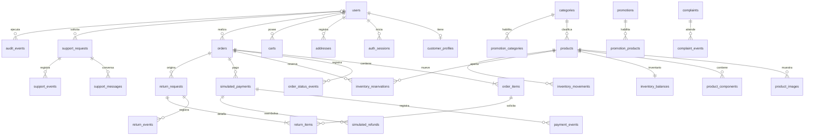

# Modelo de datos — RHEYF MARKET

**Motor**: Microsoft SQL Server. **Convenciones**: nombres `snake_case`; PK `BIGINT IDENTITY` salvo códigos públicos, UTC en `DATETIME2(0)`, dinero `DECIMAL(12,2)` PEN, cantidades enteras positivas; `rowversion` solo para detectar actualizaciones administrativas concurrentes. Los importes que integran el historial de una compra se guardan como snapshots. Las relaciones se restringen con FK; no usar cascada para borrar pedidos, pagos o movimientos.

## Relación entre entidades

`users.role` distingue `CLIENTE` y `ADMINISTRADOR`; visitantes no tienen fila. Categorías iniciales se insertan como datos semilla: Verduras, Frutas pequeñas y Plantas aromáticas.

## Tablas

### Identidad y direcciones

| Tabla | Campos (tipo; nulabilidad; clave/regla) |
|---|---|
| `users` | `user_id BIGINT IDENTITY PK`; `email NVARCHAR(254) NOT NULL UNIQUE` guardado normalizado a minúsculas para unicidad sin diferencias de mayúsculas; `password_hash NVARCHAR(255) NOT NULL`; `role VARCHAR(20) NOT NULL CHECK IN ('CLIENTE','ADMINISTRADOR')`; `is_active BIT NOT NULL DEFAULT 1`; `created_at_utc DATETIME2(0) NOT NULL`; `updated_at_utc DATETIME2(0) NOT NULL`; `row_version ROWVERSION`. El registro público siempre asigna CLIENTE. |
| `customer_profiles` | `user_id BIGINT PK/FK users`; `first_name NVARCHAR(100) NOT NULL`; `last_name NVARCHAR(100) NOT NULL`; `phone NVARCHAR(30) NULL`; `document_type VARCHAR(12) NULL`; `document_number NVARCHAR(20) NULL`; `updated_at_utc DATETIME2(0) NOT NULL`. Minimizar exposición del documento personal y limitar su uso a procesos que lo requieren. |
| `auth_sessions` | `session_id BIGINT IDENTITY PK`; `user_id BIGINT NOT NULL FK users`; `token_hash BINARY(32) NOT NULL UNIQUE`; `created_at_utc DATETIME2(0) NOT NULL`; `last_seen_at_utc DATETIME2(0) NOT NULL`; `expires_at_utc DATETIME2(0) NOT NULL`; `revoked_at_utc DATETIME2(0) NULL`; `user_agent NVARCHAR(300) NULL`. Token aleatorio en cookie; solo su SHA-256 se persiste. |
| `addresses` | `address_id BIGINT IDENTITY PK`; `user_id BIGINT NOT NULL FK users`; `recipient_name NVARCHAR(150) NOT NULL`; `phone NVARCHAR(30) NOT NULL`; `department/province/district NVARCHAR(100) NOT NULL`; `address_line NVARCHAR(300) NOT NULL`; `reference NVARCHAR(250) NULL`; `is_default BIT NOT NULL DEFAULT 0`; `created_at_utc DATETIME2(0) NOT NULL`; `updated_at_utc DATETIME2(0) NOT NULL`. Validar propiedad del usuario en cada operación. No eliminar si existe snapshot de pedido que la referencia. |

### Catálogo y cobertura

| Tabla | Campos (tipo; nulabilidad; clave/regla) |
|---|---|
| `categories` | `category_id INT IDENTITY PK`; `name NVARCHAR(100) NOT NULL UNIQUE`; `slug VARCHAR(120) NOT NULL UNIQUE`; `description NVARCHAR(500) NULL`; `is_active BIT NOT NULL DEFAULT 1`; `sort_order SMALLINT NOT NULL DEFAULT 0`. |
| `products` | `product_id BIGINT IDENTITY PK`; `category_id INT NOT NULL FK categories`; `sku NVARCHAR(60) NOT NULL UNIQUE`; `name NVARCHAR(180) NOT NULL`; `slug NVARCHAR(220) NOT NULL UNIQUE`; `description NVARCHAR(2000) NOT NULL`; `species NVARCHAR(120) NOT NULL`; `variety NVARCHAR(120) NULL`; `difficulty VARCHAR(15) NOT NULL CHECK IN ('PRINCIPIANTE','INTERMEDIO','AVANZADO')`; `recommended_space NVARCHAR(300) NOT NULL`; `light_requirements NVARCHAR(500) NOT NULL`; `cultivation_instructions NVARCHAR(MAX) NOT NULL`; `price DECIMAL(12,2) NOT NULL CHECK (price >= 0)`; `is_published BIT NOT NULL DEFAULT 0`; `is_featured BIT NOT NULL DEFAULT 0`; `created_at_utc DATETIME2(0) NOT NULL`; `updated_at_utc DATETIME2(0) NOT NULL`; `row_version ROWVERSION`. Precio es PEN. |
| `product_components` | `component_id BIGINT IDENTITY PK`; `product_id BIGINT NOT NULL FK products`; `name NVARCHAR(150) NOT NULL`; `quantity DECIMAL(10,3) NOT NULL CHECK (quantity > 0)`; `unit NVARCHAR(30) NOT NULL`; `sort_order SMALLINT NOT NULL DEFAULT 0`. Contenido del kit con cantidades. |
| `product_images` | `image_id BIGINT IDENTITY PK`; `product_id BIGINT NOT NULL FK products`; `image_url NVARCHAR(1000) NOT NULL`; `alt_text NVARCHAR(250) NOT NULL`; `sort_order SMALLINT NOT NULL DEFAULT 0`; `is_primary BIT NOT NULL DEFAULT 0`. Como máximo una imagen primaria por producto (índice único filtrado). |
| `delivery_districts` | `district_id INT IDENTITY PK`; `department/province/district NVARCHAR(100) NOT NULL`; `delivery_fee DECIMAL(12,2) NOT NULL CHECK (delivery_fee >= 0)`; `is_enabled BIT NOT NULL DEFAULT 1`; `UNIQUE(department, province, district)`. Tarifa copiada al pedido. |
| `peru_business_calendar` | `calendar_date DATE PK`; `is_business_day BIT NOT NULL`; `description NVARCHAR(150) NULL`. Cargado con fines de semana y días no laborables aplicables; se usa para calcular fecha límite en 15 días hábiles. La fuente/calendario operativo se mantiene documentada antes de lanzamiento. |

### Carrito, promociones y cotización

| Tabla | Campos (tipo; nulabilidad; clave/regla) |
|---|---|
| `carts` | `cart_id BIGINT IDENTITY PK`; `user_id BIGINT NULL FK users`; `anonymous_key_hash BINARY(32) NULL UNIQUE`; `created_at_utc DATETIME2(0) NOT NULL`; `updated_at_utc DATETIME2(0) NOT NULL`; `expires_at_utc DATETIME2(0) NULL`. Debe tener exactamente un propietario autenticado o clave anónima. Clave anónima no contiene valor original. |
| `cart_items` | `cart_item_id BIGINT IDENTITY PK`; `cart_id BIGINT NOT NULL FK carts`; `product_id BIGINT NOT NULL FK products`; `quantity INT NOT NULL CHECK (quantity > 0)`; `added_at_utc DATETIME2(0) NOT NULL`; `UNIQUE(cart_id, product_id)`. Precio mostrado se recalcula desde catálogo; no es autoritativo. |
| `promotions` | `promotion_id BIGINT IDENTITY PK`; `name NVARCHAR(150) NOT NULL`; `kind VARCHAR(12) NOT NULL CHECK IN ('PORCENTAJE','MONTO_FIJO')`; `value DECIMAL(12,2) NOT NULL CHECK (value > 0)`; `starts_at_utc DATETIME2(0) NOT NULL`; `ends_at_utc DATETIME2(0) NOT NULL CHECK (ends_at_utc > starts_at_utc)`; `minimum_subtotal DECIMAL(12,2) NOT NULL DEFAULT 0`; `is_active BIT NOT NULL`; `created_by BIGINT NOT NULL FK users`; `created_at_utc DATETIME2(0) NOT NULL`. Porcentaje debe ser <=100, monto no supera subtotal. |
| `coupons` | `coupon_id BIGINT IDENTITY PK`; `promotion_id BIGINT NOT NULL FK promotions`; `code NVARCHAR(50) NOT NULL UNIQUE`; `max_redemptions INT NULL CHECK (max_redemptions > 0)`; `redemption_count INT NOT NULL DEFAULT 0 CHECK (redemption_count >= 0)`; `is_active BIT NOT NULL DEFAULT 1`. |
| `promotion_products` | `promotion_id BIGINT NOT NULL FK promotions`; `product_id BIGINT NOT NULL FK products`; `PRIMARY KEY(promotion_id, product_id)`. |
| `promotion_categories` | `promotion_id BIGINT NOT NULL FK promotions`; `category_id INT NOT NULL FK categories`; `PRIMARY KEY(promotion_id, category_id)`. Si ambas listas están vacías, alcance general; si hay lista, debe coincidir al menos un producto/categoría elegible. |

La cotización de checkout se recalcula en servidor. Solo la cotización confirmada se vuelve snapshot inmutable en `orders` y `order_items`; no se necesita persistir un borrador adicional de cotización.

### Pedidos, pagos e inventario

| Tabla | Campos (tipo; nulabilidad; clave/regla) |
|---|---|
| `orders` | `order_id BIGINT IDENTITY PK`; `public_code UNIQUEIDENTIFIER NOT NULL UNIQUE`; `user_id BIGINT NOT NULL FK users`; `status VARCHAR(24) NOT NULL CHECK IN ('PENDIENTE_PAGO','CONFIRMADO','EN_PREPARACION','DESPACHADO','ENTREGADO','CANCELADO')`; `currency CHAR(3) NOT NULL DEFAULT 'PEN' CHECK(currency='PEN')`; `items_subtotal DECIMAL(12,2) NOT NULL CHECK >=0`; `discount_total DECIMAL(12,2) NOT NULL CHECK >=0`; `delivery_fee DECIMAL(12,2) NOT NULL CHECK >=0`; `grand_total DECIMAL(12,2) NOT NULL CHECK >=0`; `promotion_id BIGINT NULL FK promotions`; `coupon_code_snapshot NVARCHAR(50) NULL`; snapshot `recipient_name`, `phone`, `department`, `province`, `district`, `address_line`, `reference`; `shipment_reference NVARCHAR(120) NULL`; `created_at_utc DATETIME2(0) NOT NULL`; `confirmed_at_utc DATETIME2(0) NULL`; `cancelled_at_utc DATETIME2(0) NULL`; `reservation_expires_at_utc DATETIME2(0) NULL`; `row_version ROWVERSION`. El total debe coincidir con subtotal - descuento + envío; proteger también en servicio/transacción porque CHECK no puede validar otras filas. La referencia de envío es manual, sin integración de transportista. |
| `order_items` | `order_item_id BIGINT IDENTITY PK`; `order_id BIGINT NOT NULL FK orders`; `product_id BIGINT NOT NULL FK products`; `sku_snapshot NVARCHAR(60) NOT NULL`; `product_name_snapshot NVARCHAR(180) NOT NULL`; `quantity INT NOT NULL CHECK (quantity > 0)`; `unit_price DECIMAL(12,2) NOT NULL CHECK >=0`; `discount_amount DECIMAL(12,2) NOT NULL CHECK >=0`; `line_subtotal DECIMAL(12,2) NOT NULL CHECK >=0`; `line_total DECIMAL(12,2) NOT NULL CHECK >=0`; `UNIQUE(order_id, product_id)`. No borrar productos con historial; conservar referencia o permitir FK a producto inactivo. |
| `order_status_events` | `event_id BIGINT IDENTITY PK`; `order_id BIGINT NOT NULL FK orders`; `from_status VARCHAR(24) NULL`; `to_status VARCHAR(24) NOT NULL`; `actor_user_id BIGINT NULL FK users` (NULL para vencimiento automático); `note NVARCHAR(500) NULL`; `created_at_utc DATETIME2(0) NOT NULL`. Historial append-only. |
| `inventory_balances` | `product_id BIGINT PK/FK products`; `on_hand INT NOT NULL CHECK (on_hand >= 0)`; `updated_at_utc DATETIME2(0) NOT NULL`; `row_version ROWVERSION`. Disponibilidad = on_hand menos suma de reservas activas; jamás mostrar negativo. |
| `inventory_reservations` | `reservation_id BIGINT IDENTITY PK`; `order_id BIGINT NOT NULL FK orders`; `product_id BIGINT NOT NULL FK products`; `quantity INT NOT NULL CHECK (quantity > 0)`; `status VARCHAR(12) NOT NULL CHECK IN ('ACTIVA','CONVERTIDA','LIBERADA')`; `expires_at_utc DATETIME2(0) NOT NULL`; `created_at_utc DATETIME2(0) NOT NULL`; `resolved_at_utc DATETIME2(0) NULL`; `UNIQUE(order_id, product_id)`. Solo una reserva activa por producto/pedido. |
| `inventory_movements` | `movement_id BIGINT IDENTITY PK`; `product_id BIGINT NOT NULL FK products`; `order_id BIGINT NULL FK orders`; `reservation_id BIGINT NULL FK inventory_reservations`; `actor_user_id BIGINT NULL FK users`; `kind VARCHAR(16) NOT NULL CHECK IN ('ENTRADA','AJUSTE','SALIDA','RESERVA','VENTA','LIBERACION','CANCELACION','DEVOLUCION')`; `delta_on_hand INT NOT NULL`; `delta_reserved INT NOT NULL`; `reason NVARCHAR(500) NOT NULL`; `idempotency_key UNIQUEIDENTIFIER NOT NULL UNIQUE`; `created_at_utc DATETIME2(0) NOT NULL`. Ledger inmutable; valores y saldo resultante se modifican juntos en una transacción. `CANCELACION` restaura unidades vendidas de un pedido aprobado cancelado antes del despacho; `DEVOLUCION` solo repone tras inspección favorable. |
| `simulated_payments` | `payment_id BIGINT IDENTITY PK`; `order_id BIGINT NOT NULL FK orders`; `attempt_number SMALLINT NOT NULL CHECK >0`; `amount DECIMAL(12,2) NOT NULL CHECK >=0`; `status VARCHAR(12) NOT NULL CHECK IN ('PENDIENTE','APROBADO','RECHAZADO','VENCIDO')`; `idempotency_key UNIQUEIDENTIFIER NOT NULL UNIQUE`; `created_at_utc DATETIME2(0) NOT NULL`; `resolved_at_utc DATETIME2(0) NULL`; `resolved_by BIGINT NULL FK users`; `UNIQUE(order_id, attempt_number)`. Sin PAN, CVV, fecha de vencimiento ni credenciales bancarias. Un solo pago aprobado por pedido (índice único filtrado). |
| `payment_events` | `event_id BIGINT IDENTITY PK`; `payment_id BIGINT NOT NULL FK simulated_payments`; `from_status VARCHAR(12) NULL`; `to_status VARCHAR(12) NOT NULL`; `actor_user_id BIGINT NULL FK users`; `created_at_utc DATETIME2(0) NOT NULL`; `note NVARCHAR(500) NULL`. Append-only para auditar resultado y resolución administrativa. |
| `simulated_refunds` | `refund_id BIGINT IDENTITY PK`; `payment_id BIGINT NOT NULL FK simulated_payments`; `return_request_id BIGINT NULL FK return_requests`; `amount DECIMAL(12,2) NOT NULL CHECK (amount > 0)`; `status VARCHAR(12) NOT NULL CHECK IN ('PENDIENTE','APROBADO','RECHAZADO')`; `reason NVARCHAR(500) NOT NULL`; `idempotency_key UNIQUEIDENTIFIER NOT NULL UNIQUE`; `created_by BIGINT NOT NULL FK users`; `created_at_utc DATETIME2(0) NOT NULL`; `resolved_at_utc DATETIME2(0) NULL`. Nunca exceder monto pagado neto de reembolsos aprobados. |

### Reclamos, devoluciones, chatbot y auditoría

| Tabla | Campos (tipo; nulabilidad; clave/regla) |
|---|---|
| `complaints` | `complaint_id BIGINT IDENTITY PK`; `complaint_number BIGINT NOT NULL UNIQUE` correlativo visible; `access_token_hash BINARY(32) NOT NULL UNIQUE` para copia/consulta privada; `user_id BIGINT NULL FK users`; `order_id BIGINT NULL FK orders`; `consumer_name NVARCHAR(180) NOT NULL`; `document_type VARCHAR(12) NOT NULL`; `document_number NVARCHAR(20) NOT NULL`; `consumer_email NVARCHAR(254) NOT NULL`; `consumer_phone NVARCHAR(30) NULL`; `copy_channel VARCHAR(12) NOT NULL CHECK IN ('CORREO','PRESENCIAL')`; `kind VARCHAR(12) NOT NULL CHECK IN ('QUEJA','RECLAMO')`; `product_or_service NVARCHAR(250) NOT NULL`; `amount_claimed DECIMAL(12,2) NULL CHECK >=0`; `description NVARCHAR(4000) NOT NULL`; `requested_solution NVARCHAR(2000) NOT NULL`; `status VARCHAR(24) NOT NULL CHECK IN ('RECIBIDA','EN_REVISION','REQUIERE_INFORMACION','RESUELTA','CERRADA')`; `created_at_utc DATETIME2(0) NOT NULL`; `response_due_at_utc DATETIME2(0) NOT NULL`; `response_text NVARCHAR(4000) NULL`; `response_channel VARCHAR(12) NULL`; `responded_at_utc DATETIME2(0) NULL`. Al crear, el token se entrega una vez al consumidor y solo se persiste su hash; una consulta exige número correlativo y token, no enumera solicitudes. |
| `complaint_events` | `event_id BIGINT IDENTITY PK`; `complaint_id BIGINT NOT NULL FK complaints`; `from_status VARCHAR(24) NULL`; `to_status VARCHAR(24) NOT NULL`; `actor_user_id BIGINT NULL FK users`; `public_message NVARCHAR(2000) NULL`; `internal_note NVARCHAR(1000) NULL`; `created_at_utc DATETIME2(0) NOT NULL`. |
| `return_requests` | `return_request_id BIGINT IDENTITY PK`; `public_code UNIQUEIDENTIFIER NOT NULL UNIQUE`; `order_id BIGINT NOT NULL FK orders`; `user_id BIGINT NOT NULL FK users`; `reason_type VARCHAR(24) NOT NULL CHECK IN ('CAMBIO_OPINION','DEFECTO','FALTA_CONFORMIDAD','OTRO')`; `description NVARCHAR(2000) NOT NULL`; `status VARCHAR(24) NOT NULL CHECK IN ('RECIBIDA','EN_EVALUACION','APROBADA','PRODUCTO_RECIBIDO','REEMBOLSADA','RECHAZADA','CERRADA')`; `requested_at_utc DATETIME2(0) NOT NULL`; `decision_at_utc DATETIME2(0) NULL`; `received_at_utc DATETIME2(0) NULL`; `inspected_at_utc DATETIME2(0) NULL`; `inspection_result VARCHAR(16) NULL CHECK IN ('APTA','NO_APTA')`; `resolved_by BIGINT NULL FK users`; `resolution_note NVARCHAR(2000) NULL`. Grafo de transiciones: Recibida → En evaluación → Aprobada → Producto recibido → Reembolsada → Cerrada, o En evaluación → Rechazada → Cerrada. Regla de 7 días se evalúa en servicio para cambio de opinión; no restringe motivo por defecto/falta de conformidad. |
| `return_items` | `return_item_id BIGINT IDENTITY PK`; `return_request_id BIGINT NOT NULL FK return_requests`; `order_item_id BIGINT NOT NULL FK order_items`; `quantity INT NOT NULL CHECK (quantity > 0)`; `unit_refund_amount DECIMAL(12,2) NOT NULL CHECK >=0`; `restock_quantity INT NOT NULL DEFAULT 0 CHECK (restock_quantity >= 0)`; `UNIQUE(return_request_id, order_item_id)`. Cantidad acumulada devuelta no supera unidades de línea. |
| `return_events` | `event_id BIGINT IDENTITY PK`; `return_request_id BIGINT NOT NULL FK return_requests`; `from_status VARCHAR(24) NULL`; `to_status VARCHAR(24) NOT NULL`; `actor_user_id BIGINT NULL FK users`; `decision NVARCHAR(1000) NULL`; `created_at_utc DATETIME2(0) NOT NULL`. Append-only y valida grafo FR-047. |
| `support_requests` | `support_request_id BIGINT IDENTITY PK`; `public_code UNIQUEIDENTIFIER NOT NULL UNIQUE`; `user_id BIGINT NULL FK users`; `contact_email NVARCHAR(254) NULL`; `subject NVARCHAR(180) NOT NULL`; `status VARCHAR(24) NOT NULL CHECK IN ('RECIBIDA','EN_REVISION','REQUIERE_INFORMACION','RESUELTA','CERRADA')`; `source VARCHAR(12) NOT NULL CHECK IN ('CHATBOT','FORMULARIO')`; `created_at_utc DATETIME2(0) NOT NULL`; `updated_at_utc DATETIME2(0) NOT NULL`. Al menos usuario o correo de contacto. Para visitante, acceso de seguimiento mediante referencia y verificación del contacto. |
| `support_messages` | `message_id BIGINT IDENTITY PK`; `support_request_id BIGINT NOT NULL FK support_requests`; `sender_type VARCHAR(12) NOT NULL CHECK IN ('CLIENTE','ADMIN','BOT')`; `sender_user_id BIGINT NULL FK users`; `body NVARCHAR(4000) NOT NULL`; `created_at_utc DATETIME2(0) NOT NULL`. Guardar solo contenido necesario para la atención. |
| `support_events` | `event_id BIGINT IDENTITY PK`; `support_request_id BIGINT NOT NULL FK support_requests`; `from_status VARCHAR(24) NULL`; `to_status VARCHAR(24) NOT NULL`; `actor_user_id BIGINT NULL FK users`; `created_at_utc DATETIME2(0) NOT NULL`; `note NVARCHAR(500) NULL`. Guarda transiciones de solicitud por FR-025/046. |
| `audit_events` | `audit_event_id BIGINT IDENTITY PK`; `actor_user_id BIGINT NULL FK users`; `action VARCHAR(80) NOT NULL`; `entity_type VARCHAR(60) NOT NULL`; `entity_id NVARCHAR(80) NOT NULL`; `before_json NVARCHAR(MAX) NULL`; `after_json NVARCHAR(MAX) NULL`; `created_at_utc DATETIME2(0) NOT NULL`; `correlation_id UNIQUEIDENTIFIER NOT NULL`. Excluir secretos, hashes, datos bancarios y contenido personal que no sea necesario. Append-only para aplicación. |

## Restricciones e índices

Además de PK/FK/UNIQUE/CHECK descritos arriba, crear índices:

| Índice | Finalidad |
|---|---|
| `products(is_published, category_id, price, difficulty) INCLUDE(name, species)`; índice no clusterizado y estrategia de búsqueda revisable con datos reales | Catálogo con filtros y orden por precio. Para búsqueda de texto, evaluar catálogo full-text nativo solo si nombre/especie/descripción lo justifican; búsqueda simple inicial puede usar índices adecuados y `LIKE`. |
| `product_images(product_id, sort_order)` y único filtrado `product_id WHERE is_primary=1` | Ficha y orden de imágenes. |
| `auth_sessions(user_id, expires_at_utc) INCLUDE(revoked_at_utc)`; único `token_hash` | Validar sesión/revocar sesiones vencidas. |
| `carts(user_id, updated_at_utc)`; `cart_items(cart_id)` | Recuperar carrito del usuario. |
| `orders(user_id, created_at_utc DESC)`; `orders(status, reservation_expires_at_utc)` filtrado donde `status='PENDIENTE_PAGO'` | Historial propio, panel y worker de vencimientos. |
| `order_status_events(order_id, created_at_utc)` | Seguimiento cronológico. |
| `inventory_reservations(status, expires_at_utc, product_id)` filtrado `status='ACTIVA'`; `inventory_reservations(order_id)` | Verificar disponibilidad y expirar apartados. |
| `inventory_movements(product_id, created_at_utc DESC)`; `inventory_movements(order_id)` | Kardex y revisión de cambios. |
| `simulated_payments(order_id, created_at_utc)`; único filtrado `order_id WHERE status='APROBADO'` | Intentos e impedir doble aprobación. |
| `payment_events(payment_id, created_at_utc)` | Cronología de cambios de cada intento. |
| `simulated_refunds(payment_id, status)` | Conciliar pagos y reembolsos. |
| `complaints(status, response_due_at_utc)`; `complaint_events(complaint_id, created_at_utc)` | Priorizar vencimientos y auditar respuesta. |
| `return_requests(user_id, requested_at_utc)`; `return_requests(status, requested_at_utc)`; `return_events(return_request_id, created_at_utc)` | Consulta cliente, cola y cronología administrativa. |
| `support_requests(user_id, updated_at_utc)`; `support_messages(support_request_id, created_at_utc)`; `support_events(support_request_id, created_at_utc)` | Conversaciones propias y bandeja de atención. |
| `audit_events(entity_type, entity_id, created_at_utc)` | Consultar auditoría por entidad. |

Los índices se confirman con planes de consulta una vez exista volumen de datos. No se añade búsqueda especializada ni almacenamiento adicional antes de medir.

Las migraciones deben crear `return_requests` antes de agregar la FK `simulated_refunds.return_request_id`; los eventos se crean después de sus tablas principales. Las FK circulares se evitan; donde se declara una relación opcional solo se crea una FK en sentido hijo → padre.

## Invariantes transaccionales

1. **Crear pedido y reserva**: validar dueño del carrito, publicación, precio, promoción, tarifa de distrito, cada saldo disponible, y un único cupón candidato. Dentro de una transacción corta, tomar bloqueos de actualización en productos en orden ascendente de `product_id`, recalcular unidades disponibles, crear pedido/líneas/snapshots, crear reservas y movimientos de reserva, incrementar comprometido y vaciar/consumir el carrito. Si algo falla, rollback completo. Guardar idempotencia para la solicitud de checkout.
2. **Aprobación**: comprobar que intento y reserva están vigentes y que pedido sigue `PENDIENTE_PAGO`; en la misma transacción marcar pago aprobado, decrementar `on_hand`, convertir reservas, emitir movimientos `VENTA`, y cambiar pedido a `CONFIRMADO` con evento. Restricción única e idempotencia garantizan un efecto. Nunca aprobar después de vencimiento.
3. **Rechazo/pendiente**: rechazo conserva reserva mientras siga viva y permite siguiente intento; pendiente bloquea nuevos intentos; resolución de admin exige reserva vigente. No se decrementa inventario físico hasta aprobación.
4. **Expirar/cancelar**: serializar con aprobación usando el pedido como recurso de exclusión. Si pendiente, liberar reservas activas una vez sin tocar el stock físico. Si aprobado y aún no despachado, cancelar solo por Administrador, registrar reembolso simulado y movimiento `CANCELACION` que restaura lo no enviado. Después del despacho se exige devolución, nunca cancelación directa.
5. **Ajuste administrativo**: actor administrador, motivo requerido, cantidad válida; no permitir que el nuevo saldo físico quede por debajo de reserva activa. Actualizar balance y agregar movimiento en transacción.
6. **Devolución**: registrar decisión, reembolso simulado y saldo reembolsado sin exceder pago neto; el movimiento de devolución incrementa `on_hand` únicamente después de inspección favorable, y se registra idempotentemente.
7. **Totales**: importes en PEN redondeados a 2 decimales mediante una sola política de redondeo en servidor. `grand_total = items_subtotal - discount_total + delivery_fee`; pedido conserva los valores autorizados al confirmar.
8. **Transiciones**: servicio valida grafo de estado antes de actualizar estado y append de evento/auditoría. Los eventos históricos no se editan ni se eliminan.

## Trazabilidad del alcance

El modelo cubre cuentas y sesiones, clientes/direcciones, categorías/kits/imágenes, carrito, cobertura, promociones/cupones, pedidos y snapshots, reservas y ledger de inventario, pagos/reembolsos simulados, reclamos, devoluciones, soporte/chatbot, dashboard/reportes derivados y auditoría solicitados en `spec.md`. No incorpora pagos reales, transportistas, inventarios multi-almacén ni marketplace.
